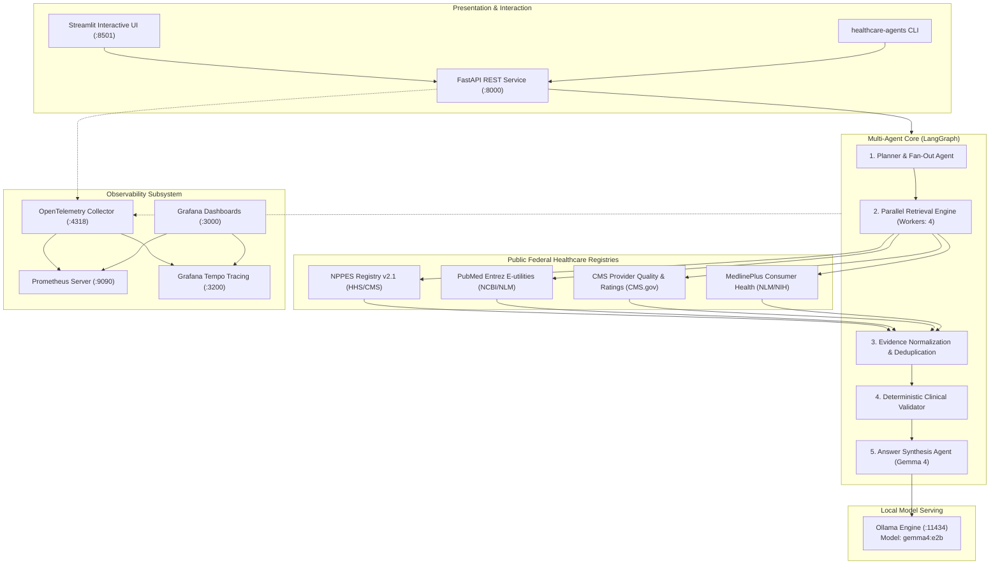

# Open Healthcare Agentic Platform

[](https://pypi.org/project/open-healthcare-agentic-platform/)
[](https://www.python.org/)
[](https://github.com/hastimal/open-healthcare-agentic-platform/actions/workflows/ci.yml)
[](LICENSE)
[](https://github.com/hastimal/open-healthcare-agentic-platform/pkgs/container/open-healthcare-api)

> **Vendor-neutral, open-source, evidence-grounded healthcare search and agentic AI platform** using Python, Gemma 4, Ollama, LangGraph, Docker, Kubernetes, Helm, and OpenTelemetry.

---

## ⚡ 10-Minute Quick Start (Zero-Install)

Run the platform without cloning the repository or manually managing environments:

```bash
# 1. Run local diagnostic checks (Python, Ports, Ollama, Gemma 4, Docker)
uvx --from open-healthcare-agentic-platform healthcare-agents check

# 2. Launch the platform (Starts FastAPI on :8000 & Streamlit UI on :8501)
uvx --from open-healthcare-agentic-platform healthcare-agents start
```
The CLI automatically launches your web browser to `http://localhost:8501`.

To stop managed background services:
```bash
healthcare-agents stop
```

---

## 📖 Table of Contents

- [1. Overview & Problem Statement](#1-overview--problem-statement)
- [2. Key Capabilities](#2-key-capabilities)
- [3. System Architecture](#3-system-architecture)
- [4. Installation Pathways](#4-installation-pathways)
- [5. First Healthcare Agent Walkthrough](#5-first-healthcare-agent-walkthrough)
- [6. Authoritative Healthcare Data Sources](#6-authoritative-healthcare-data-sources)
- [7. Observability & Telemetry](#7-observability--telemetry)
- [8. Visual Interface & Walkthrough](#8-visual-interface--walkthrough)
- [9. CLI Reference](#9-cli-reference)
- [10. Community Issues & Enhancement Roadmap](#10-community-issues--enhancement-roadmap)
- [11. Contributing & Developer Setup](#11-contributing--developer-setup)
- [12. Clinical & Research Disclaimer](#12-clinical--research-disclaimer)
- [13. License](#13-license)

---

## 1. Overview & Problem Statement

Navigating clinical research, healthcare provider rosters, quality metrics, and patient guidance is frequently hindered by fragmented federal databases, proprietary cloud lock-in, and hallucination-prone AI models.

The **Open Healthcare Agentic Platform** solves this by providing a completely open-source, vendor-neutral agentic architecture. By anchoring autonomous agents to authoritative public federal datasets, the platform enables verifiable, citation-backed discovery for clinicians, researchers, and patients without relying on proprietary cloud APIs or subscription keys.

---

## 2. Key Capabilities

- **4-Source Federal Healthcare Retrieval**: Concurrently queries CMS NPPES (providers), NCBI PubMed (biomedical research), CMS Provider Data (clinician/facility quality), and NLM MedlinePlus (consumer health education).
- **Intelligent Query Fan-Out**: The Planner agent dynamically converts conversational patient or clinical questions into targeted, specialized query strings across all 4 federal APIs.
- **Deterministic Validation & Provenance**: Enforces deterministic deduplication, NPI checksums, domain allowlisting (`nih.gov`, `cms.gov`, `hhs.gov`), and cryptographic audit hashes.
- **Local AI Inference**: Powered by Google Gemma 4 served locally via Ollama with zero telemetry leak or external token billing.
- **CNCF-Standard Observability**: End-to-end W3C distributed tracing, Prometheus metrics, and pre-configured Grafana dashboards for agent spans and retrieval latencies.
- **Production Packaging**: Distributed as a PEP 517 Python package, multi-arch Docker containers (AMD64/ARM64), and Kubernetes Helm OCI charts.

---

## 3. System Architecture

The platform follows a layered, cloud-native architecture connecting presentation interfaces to a LangGraph multi-agent core, external federal APIs, and observability services:



*For detailed architectural breakdowns, see [docs/architecture/overview.md](docs/architecture/overview.md).*

---

## 4. Installation Pathways

Select the pathway suited for your workflow:

| Pathway | Target Audience | Command | Documentation |
| :--- | :--- | :--- | :--- |
| **PyPI / uvx** | Developers, Analysts | `uvx --from open-healthcare-agentic-platform healthcare-agents start` | [Installation Guide](docs/getting-started/installation.md#pathway-a-one-command-zero-install-pypi--uvx) |
| **Docker Compose** | Engineers, Observers | `docker compose up -d` | [Installation Guide](docs/getting-started/installation.md#pathway-b-docker-compose-deployment) |
| **Kubernetes / Kind** | Platform Engineers | `python scripts/k8s_deploy.py` | [Installation Guide](docs/getting-started/installation.md#pathway-c-local-kubernetes-kind) |
| **Helm OCI** | Cloud Deployments | `helm install healthcare oci://ghcr.io/hastimal/charts/open-healthcare --version 0.10.2` | [Installation Guide](docs/getting-started/installation.md#pathway-d-helm-oci-chart-installation) |

---

## 5. First Healthcare Agent Walkthrough

1. **Verify Prerequisites**:
   ```bash
   healthcare-agents check
   ```
2. **Start Platform**:
   ```bash
   healthcare-agents start
   ```
3. **Execute a Discovery Query**:
   In Streamlit (`http://localhost:8501`), select a clinical preset such as *"Find pediatric dentists in Houston with hospital affiliations"*.
4. **Inspect Multi-Source Evidence**:
   - **Grounded Answer**: Clinical narrative generated by Gemma 4 with verified citations.
   - **Clinicians**: 10-digit NPIs, practice locations, and hospital affiliations from CMS NPPES.
   - **Literature**: Relevant peer-reviewed clinical studies with PMIDs and DOIs from NCBI PubMed.
   - **Patient Education**: Structured consumer health topics from NLM MedlinePlus.
   - **Provenance Ledger**: Cryptographic audit hashes and authorized federal domain stamps (`nih.gov`, `cms.gov`, `hhs.gov`).
5. **View Execution Spans**: Click the **"🧠 Agent Execution & Observability"** tab to inspect stage durations, dispatched API queries, and W3C Trace IDs.

*For complete walkthrough details, see [docs/getting-started/first-demo.md](docs/getting-started/first-demo.md).*

---

## 6. Authoritative Healthcare Data Sources

The platform communicates live with 4 public healthcare repositories:

1. **NPPES (National Plan and Provider Enumeration System)**: Registry for healthcare providers, National Provider Identifiers (NPIs), practice locations, and medical specialties.
2. **PubMed (NCBI Entrez E-utilities)**: Peer-reviewed biomedical literature, clinical research, and scientific citations.
3. **CMS Provider Data**: Centers for Medicare & Medicaid Services clinician performance metrics (MIPS) and hospital quality star ratings.
4. **MedlinePlus**: National Library of Medicine consumer health information covering conditions, wellness, and prescription drugs.

---

## 7. Observability & Telemetry

The platform provides complete OpenTelemetry instrumentation with pre-configured Grafana monitoring:

- **Metrics**: Search volume, end-to-end P50/P95/P99 latency, per-agent execution times, source retrieval latencies, and real Gemma 4 token metrics.
- **Distributed Traces**: W3C TraceContext propagation across Streamlit UI, FastAPI service, LangGraph workflow, concurrent retrieval workers, and Ollama inference.
- **Accessing Observability**:
  - Grafana: `http://localhost:3000` (Dashboard: *"Open Healthcare Agentic AI — Observability"*)
  - Prometheus: `http://localhost:9090`
  - Tempo: `http://localhost:3200`

*For complete configuration and troubleshooting, see [docs/observability/README.md](docs/observability/README.md).*

---

## 8. Visual Interface & Walkthrough

| Interface View | Visual Asset | Description |
| :--- | :--- | :--- |
| **Streamlit Search & Presets** |  | Interactive clinical discovery presets, readiness health badges, and search bar. |
| **Grounded Discovery Results** |  | Synthesized narrative with federal citations, provider roster, and literature evidence. |
| **Agent Execution Telemetry** |  | Monotonic stage timings, dispatched federal queries, and concurrency breakdown. |
| **Grafana Platform Observability** |  | Real-time platform throughput, P50/P95/P99 latency measurements, and HTTP status codes. |
| **Tempo Distributed Trace Tree** |  | Full span waterfall tracking requests from UI through retrievers to Ollama inference. |

---

## 9. CLI Reference

```bash
# Display installed package version
healthcare-agents --version

# Run local diagnostic preflight checks
healthcare-agents check

# Start platform services in background (FastAPI + Streamlit UI)
healthcare-agents start

# Start on custom ports without opening browser
healthcare-agents start --api-port 9000 --ui-port 9501 --no-browser

# Stop managed platform background services
healthcare-agents stop

# Inspect service health and process IDs
healthcare-agents status

# Run terminal multi-agent search
healthcare-agents search --query "Find cardiologists in Boston" --verbose

# Run interactive demonstration wizard
healthcare-agents demo
```

*For complete flag definitions and usage, see [docs/getting-started/cli-reference.md](docs/getting-started/cli-reference.md).*

---

## 10. Community Issues & Enhancement Roadmap

Platform enhancements and future milestones are tracked transparently as open GitHub issues.

*Current issue status, discussions, and progress are maintained live on GitHub:*

| Area | GitHub Issue | Focus |
| :--- | :--- | :--- |
| **Kubernetes Deployment** | [#4](https://github.com/hastimal/open-healthcare-agentic-platform/issues/4) | Declarative manifests, Helm charts, and cluster smoke tests |
| **vLLM Inference** | [#5](https://github.com/hastimal/open-healthcare-agentic-platform/issues/5) | Optional high-throughput OpenAI-compatible vLLM serving backend |
| **Kubernetes Autoscaling** | [#6](https://github.com/hastimal/open-healthcare-agentic-platform/issues/6) | Workload-aware horizontal pod autoscaling with HPA and KEDA |
| **Observability Enhancements** | [#7](https://github.com/hastimal/open-healthcare-agentic-platform/issues/7) | Prometheus alerting rules, log correlation, and error dashboards |
| **Agentic AI Evaluation** | [#8](https://github.com/hastimal/open-healthcare-agentic-platform/issues/8) | Quantitative groundedness, citation precision, and hallucination checks |
| **Security & Privacy** | [#9](https://github.com/hastimal/open-healthcare-agentic-platform/issues/9) | Container hardening, vulnerability scanning, and PHI redaction |
| **Performance Benchmarks** | [#10](https://github.com/hastimal/open-healthcare-agentic-platform/issues/10) | Repeatable load testing, retrieval benchmarks, and concurrency profiling |
| **Healthcare Data Sources** | [#11](https://github.com/hastimal/open-healthcare-agentic-platform/issues/11) | Additional public registries (ClinicalTrials.gov, openFDA, RxNorm) |
| **Developer Experience** | [#12](https://github.com/hastimal/open-healthcare-agentic-platform/issues/12) | Diagnostic tools, automated local setup (`good first issue`) |
| **CNCF Workshop** | [#13](https://github.com/hastimal/open-healthcare-agentic-platform/issues/13) | Vendor-neutral interactive curriculum and workshop presentations |

---

## 11. Contributing & Developer Setup

We welcome contributions from open-source developers, researchers, and cloud-native engineers.

```bash
# 1. Clone repository
git clone https://github.com/hastimal/open-healthcare-agentic-platform.git
cd open-healthcare-agentic-platform

# 2. Set up virtual environment and install dependencies
python3.12 -m venv .venv
source .venv/bin/activate
pip install -e ".[dev]"

# 3. Run automated tests and quality gates
uv run ruff check .
uv run ruff format --check .
uv run mypy src tests
uv run pytest -m "not live" --cov=healthcare_agents --cov-report=term-missing
```

*For complete contribution guidelines, see [CONTRIBUTING.md](CONTRIBUTING.md),
[local demo diagnostics](docs/developer-guide.md) and [docs/README.md](docs/README.md).*

---

## 12. Clinical & Research Disclaimer

> **IMPORTANT DISCLAIMER**: This software is designed exclusively for research, education, and informational discovery. It is **NOT** a medical device, diagnostic tool, or clinical decision support system. Provider data from NPPES represents administrative identifiers under HIPAA and does not guarantee licensure or competence. Research literature retrieved from PubMed reflects published scientific literature, not universally applicable clinical protocols. Always consult a qualified physician or healthcare professional.

---

## 13. License

This project is licensed under the [Apache License 2.0](LICENSE).
