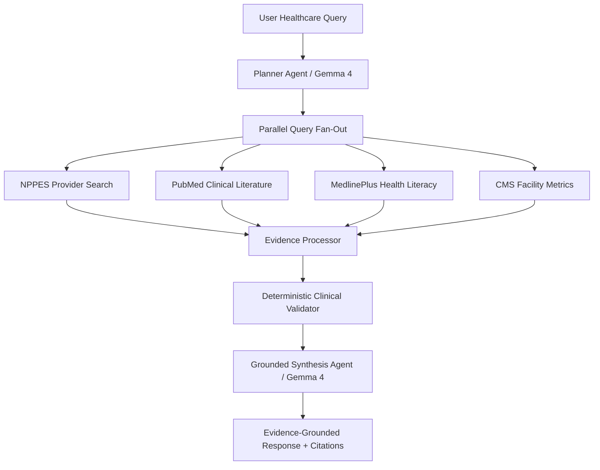

# Multi-Agent Orchestration Architecture

This document describes the design and orchestration semantics of the multi-agent system in the Open Healthcare Agentic Platform.

---

## 1. Multi-Agent Pipeline Overview

The orchestration workflow coordinates specialized agents and deterministic pipelines:

---

## 2. Agent Roles and Boundaries

### 1. Planner Agent (`healthcare_agents.agents.planner`)
- Uses LLM reasoning (Gemma 4) to parse user query intent, clinical specialty, geographic constraints, and target conditions.
- Deconstructs complex queries into specialized sub-queries tailored to external APIs.

### 2. Parallel Retriever (`healthcare_agents.retrieval.parallel_retriever`)
- Executes asynchronous, concurrent requests across external health data sources with independent circuit breakers and timeouts.

### 3. Evidence Processor (`healthcare_agents.agents.evidence_processor`)
- Deduplicates, normalizes, and ranks retrieved data according to semantic relevance and provenance.

### 4. Deterministic Clinical Validator (`healthcare_agents.agents.validator`)
- Applies non-LLM rule sets: validates NPI checksums, specialty taxonomy codes, publication dates, and clinical terms.
- Ensures no hallucinated medical entities pass downstream.

### 5. Grounded Synthesis Agent (`healthcare_agents.agents.answer`)
- Synthesizes the clinical response citing exclusively verified evidence markers (e.g. `[PubMed-Live: PMID:...]`, `[NPPES-Live: NPI:...]`).
- Appends statutory disclaimers clarifying educational and research use.
