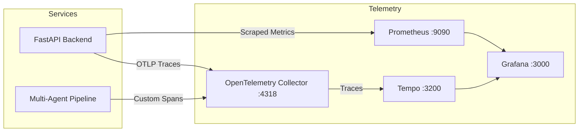

# Observability Architecture

This document describes the OpenTelemetry instrumentation, metrics, and trace propagation architecture.

---

## 1. Telemetry Pipeline

---

## 2. Distributed Tracing Spans

Every search request produces a unified trace containing nested hierarchical spans:
- `healthcare.search`: Top-level request span.
- `agent.planner`: Gemma 4 query decomposition span.
- `agent.query_fanout`: Planning and sub-query generation.
- `agent.parallel_retrieval`: Concurrently fan-out span for NPPES, PubMed, and MedlinePlus.
- `agent.evidence_processor`: Normalization and deduplication span.
- `agent.deterministic_validator`: Rule-based verification span.
- `agent.grounded_synthesis`: Gemma 4 citation-grounded response generation.
- `model.inference`: LLM token generation latency and token usage metrics (`gen_ai.usage.input_tokens`, `gen_ai.usage.output_tokens`).
